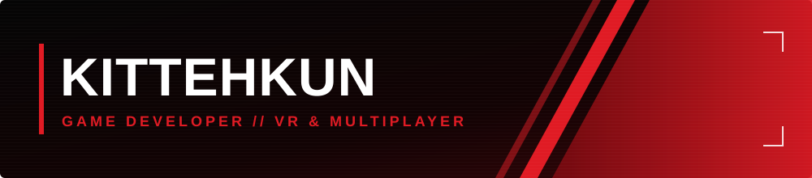

<!-- Header banner -->

  

  

# Introduction

I'm **Zach**, known online as **KittehKun**. I make multiplayer VR games for VRChat in **Unity and C#**, and thousands of people play them every day.

Right now I'm building **[Ashpoint: Zero](https://vrch.at/wrld_3d6c9459-c83e-446f-885e-a728bbed339f)** on my own. It's a PvE extraction shooter that got **60,000+ visits in its first week** after going public. Before that, I co-founded TrickForge Studios and was lead programmer on **Fish!**, which passed **10 million visits** and was featured in an official VRChat case study.

I also stream game dev as a VTuber, and my day job is in IT.

  
  
  
  
  
  
  

  
  
  
  

# Projects

<!-- FEATURED: swap the comment below for a screenshot or GIF of Ashpoint, e.g.  -->

## [Ashpoint: Zero](https://vrch.at/wrld_3d6c9459-c83e-446f-885e-a728bbed339f)
**A PvE extraction shooter for VRChat, built solo.** You start in a hub bunker with other players, then drop onto an open island to fight PMCs and Scavs, loot what you can, and extract before you lose everything.

| | |
|---|---|
| **Players** | 60,000+ visits in its first week public |
| **Gameplay** | Modular VR guns, attachment swapping, armor, stash, gunsmith bench |
| **Tech** | Custom Unity editor tools, Blender → Unity pipeline, heavy VR optimization |
| **Reach** | Localized in English and Japanese |

---

<table>
  <tr>
    <td width="50%" valign="top">
      <h3>Fish!</h3>
      Co-founder &amp; Lead Programmer · TrickForge Studios
      
A VRChat fishing game with <b>10M+ visits</b>. It reached <b>#1 in VRChat's Creator Economy</b> and VRChat featured it in an official case study. I led programming across a 250+ script codebase.

    </td>
    <td width="50%" valign="top">
      <h3>Raiders of Haven &amp; Crimson Streets</h3>
      VRChat worlds
      
My earlier VRChat worlds. Working on them is how I learned to make multiplayer VR run smoothly on the hardware real players have.

    </td>
  </tr>
  <tr>
    <td width="50%" valign="top">
      <h3><a href="https://github.com/KittehKun/Cat-Kun-Discord-Bot">Cat-Kun Discord Bot</a></h3>
      C#
      
A modular Discord bot for moderation and community management.

    </td>
    <td width="50%" valign="top">
      <h3><a href="https://github.com/KittehKun/Moving-Cat-Website">Moving Cat Website</a></h3>
      Astro · JavaScript
      
Bouncing cats. No further explanation needed.

    </td>
  </tr>
</table>

